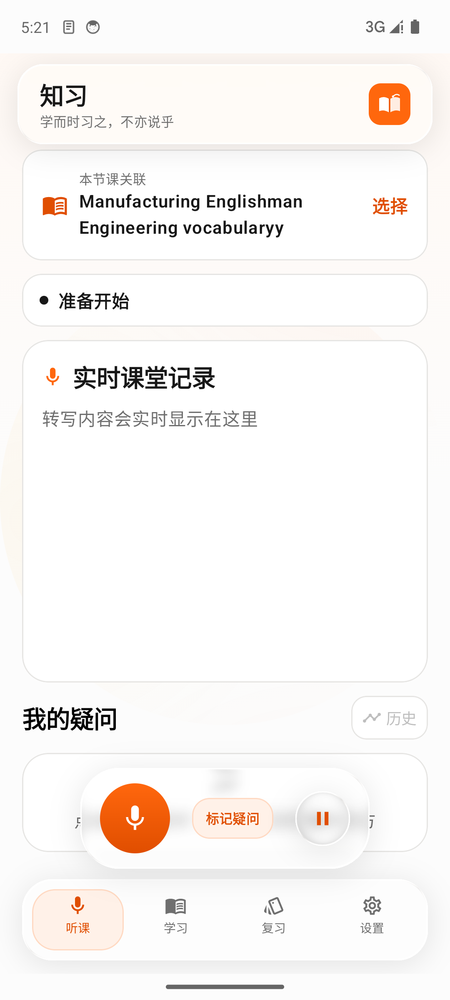

# 知习

面向外教课堂与备考场景的 Android 学习助手，覆盖听课转写与翻译、手动疑问、复杂讲义解析、AI 学习纪要和间隔复习。UI/录音与离线识别来自自有项目“水课雷达”离线版。



## 协作开发

私有协作仓库：`https://github.com/YZUSeanYan/course-companion`

当前仓库包含四个可独立运行的模块：

- `app/`：Android App
- `server/`：FastAPI 学习网关
- `admin/`：运营后台（React + Vite，由网关托管在 `/admin/`）
- `site/`：官网源码

第一次参与开发请先读：

1. [`docs/ONBOARDING.md`](docs/ONBOARDING.md)：环境安装、构建、模拟器/真机和常见问题。
2. [`AGENTS.md`](AGENTS.md)：密钥、隐私、测试、Git 和部署边界，所有 AI agent 必须遵守。
3. [`CONTRIBUTING.md`](CONTRIBUTING.md)：分支、提交、PR 和审阅流程。

不要直接向 `main` 推送，不要使用 `git add -A`，不要提交密钥、真实课堂录音、模型权重、APK 或数据库。发布与生产部署仅由项目负责人执行。


## 当前功能

- 液态玻璃与相机动效，应用名「知习」，副标题轮换“知行合一”“学而时习之，不亦说乎”。
- 本地实时课堂转写；定稿后独立 AI 翻译队列，原文优先落库，网络失败不停止录音。录音 Dock 支持开始/停止、暂停/继续和标记疑问，暂停不结束课堂。
- Lecsync 文本翻译优先，失败后按 DeepSeek→Kimi→MiMo 顺序回退；支持幂等键、504 查询和实际模型标识。
- 可选 Lecsync 云端听课：双向字幕、说话人、实时纪要、术语与 AI 润色；网络恢复失败时可用本机 sherpa 继续同一课堂。双语与纪要使用分组开关，热词和固定译法支持逐条编辑。云端音频默认不上传，30 天存储需单独开启。
- 音频工具支持同步转写、长音频任务、音频链接、Voice Typing 文件与短语音 WebSocket、任务取消/删除及云端录音下载。全部经自有网关，APK 不内置模型 API 密钥。
- 自动老师提问已退出新链路；旧识别数据只读保留。录音与课堂详情均可手动“标记疑问”，附原文，备注可留空。
- 学习项目支持自由填写课程/项目性质，课程性质会进入纪要请求。
- v2 学习纪要：按 SESSION/MATERIAL/EXAM 生成主题化纪要、词汇短语、重难点、自测卡及手动疑问参考解答。学习包通过后台任务生成，客户端用短连接轮询，移动网络短暂中断后可继续查询且不会重复创建同一讲义任务。
- 学习内容按课堂纪要、我的疑问、重点与摘要、词汇、短语、自测问答和练习分类归档；课程页先显示分类入口和数量，点开二级页面查看具体内容。复习页同样按分类汇总今日到期与卡片总数，进入分类后逐张复习，并在同一页浏览该分类全部卡片。
- 复杂文档：PDF/JPG/PNG 上传后逐页生成原图与 PageAsset；文本可靠页使用原生文本，复杂页可插拔 MinerU。支持可替换多模态模型，OCR 不冒充视觉理解。
- CET6/通用备考：按资料语境提取词汇，CET6 标准 CSV/TSV 词表确定性导入、去重并生成 FSRS 卡片。
- 原页图与解析状态展示、双语导出、AI 学习包 Markdown 导出、复习卡片与 TTS。
- 离线模型支持国内高速镜像、官方源回退、完整下载校验、卸载到应用回收站、恢复和停用；release 不内置模型权重，需在设置中下载或恢复后才能离线听课。
- 试用额度：AI 学习包、翻译、云端听课和文档解析需在「设置 → 试用额度」激活管理员发放的手机号；每日额度按 AI 包次数/音频分钟/翻译字符/文档次数配置，并有有效期。一个手机号可在多台设备上共用同一份额度，服务端按账号汇总，未激活设备返回可执行的激活引导。
- 手机号安全：服务端使用独立密钥加密保存，查找使用 HMAC 摘要；App 本地只保存脱敏号码（如 `139****0001`），隐私政策已披露用途、保留与删除方式。
- 运营后台：管理员密码登录后可查看请求/学习包/音频/翻译用量、活跃设备与账号、错误率、每日趋势、接口和模型分布；可新增/批量添加手机号、配置额度与有效期、禁用/解绑/删除账号，并查看设备与最近请求（不记录请求正文）。
- 设置内含正式隐私政策和 `https://shuike.seanyan.store` 官网入口。

## 尚未完成或需真实验收

- Lecsync 已在正式网关完成短文本翻译与 1 秒合成 Realtime 联调，APP 也已通过公网 WebSocket 开始/停止云端课堂；DeepSeek Flash、Kimi `k3.1-pro-highspeed`、MiMo `mimo-v2.6-flash` 均已分别生成真实学习包，APP 实测生成 39 项学习内容。复杂图像已启用 MiMo `mimo-v2.6-pro` → DeepSeek `deepseek-flash` 视觉回退，并用含梁图、尺寸和公式的合成工程页完成真实生成与来源校验；真实手写、密集公式版式的广泛质量仍需继续收集样本。
- 官方功能覆盖与安全边界见 `docs/LECSYNC_COMPATIBILITY.md`；Realtime/音频按时长计费，文本翻译按源字符，Voice Typing 按最终文本字符，不能混称为全部按时长免费。
- MinerU、LibreOffice 是可选本地解析器，未配置时复杂页保留原图并标记 `NEEDS_VISION_PARSER`，不伪造结构化内容。
- DOCX/PPTX 转换接口需 LibreOffice 环境；Android 文件入口目前以 TXT/PDF/图片为主。
- 复杂页一次最多送 4 页给视觉模型，需后续按页队列扩展；云端音频任务和可选录音删除已实现，真实预生成缓存样例尚未提供。
- 真实外教口音、长课续航、真机麦克风与模型成本未验收；正式 HTTPS 网关、运营后台、V2.0.4 签名包和官网下载页已完成，参赛 PPT 尚未准备。

## 本地构建

Android SDK 36、JDK 17+：

```bash
cd /c/dev/course-companion
JAVA_HOME='C:\dev\jdk-21.0.12+8' GRADLE_USER_HOME='C:\dev\gradle-home' ./gradlew.bat :app:testDebugUnitTest :app:assembleDebug
```

FastAPI（Python 3.11+）：

```bash
cd /c/dev/course-companion/server
source .venv/Scripts/activate
pip install -r requirements-dev.txt
export TOKEN_PEPPER='<随机开发值>'
export ACCOUNT_ENCRYPTION_KEY='<随机开发值>'
export DATABASE_PATH='local-dev.db'
export DOCUMENT_STORAGE_ROOT='document_assets'
uvicorn app.main:app --host 127.0.0.1 --port 8765
```

运营后台：

```bash
cd /c/dev/course-companion/admin
npm ci
npm run build
```

本地联调时给网关设置 `ADMIN_PASSWORD`（至少 8 位，建议 12 位以上）、`ADMIN_SESSION_SECRET`、`ADMIN_COOKIE_SECURE=false` 和 `ADMIN_DIST_DIR=<仓库>/admin/dist`，然后访问 `http://127.0.0.1:8765/admin/`。生产环境必须使用 HTTPS 且保持 `ADMIN_COOKIE_SECURE=true`。

文本模型使用 `AI_PROVIDER_*`；复杂图像可显式配置 `VISION_PROVIDER_*`，未配置时服务端复用已有 MiMo/DeepSeek 密钥，按 `mimo-v2.6-pro → deepseek-flash` 回退。详见 `server/.env.example` 和 `server/README.md`。密钥不得写入工程。Release 禁止明文 HTTP，正式构建通过 `-PLEARNING_API_BASE_URL=https://你的学习服务域名` 注入。

## 正式网关

- 地址：`https://zhixi.seanyan.store`。APP 的“设置 → AI 服务连接”填此域名即可，不填 Lecsync 地址或任何密钥。
- 运营后台：`https://zhixi.seanyan.store/admin/`，使用服务器 `/opt/zhixi-gateway/.env` 中的 `ADMIN_PASSWORD` 登录；后台可添加同学手机号并配置每日额度与有效期。
- 服务端以 systemd `zhixi-gateway` 运行，仅监听 `127.0.0.1:8766` 并由 nginx 提供 HTTPS；`/health` 返回 200，`/admin/` 由 nginx 代理到同一网关。
- Lecsync 密钥只保存在服务器 `/opt/zhixi-gateway/.env`（权限 600），不进入 APK。DeepSeek/Kimi/MiMo 与视觉模型需另行配置，AI 学习包和视觉功能不能仅凭 Lecsync 地址推断可用。
- 手机号在 `access_accounts` 表中以 Fernet 密文保存，查找使用 HMAC；`ACCOUNT_ENCRYPTION_KEY`、`ADMIN_PASSWORD`、`ADMIN_SESSION_SECRET` 只从服务器环境变量读取，不得写入源码或 APK。`REQUIRE_ACCOUNT_ACTIVATION=true` 为正式试用状态；紧急回退可设为 `false` 恢复旧的按设备默认额度。
- 新构建可注入默认地址：`-PLEARNING_API_BASE_URL=https://zhixi.seanyan.store`。V2.0.4 签名包位于桌面 `知习-V2.0.4.apk`，官网下载页为 `https://shuike.seanyan.store/#/download`；release 不内置模型权重，首次离线听课前需在设置中下载或恢复模型。

## AI 服务连接与离线模型下载

- 设置页可直接修改并保存 AI 服务地址，学习包、文档分析和实时翻译共用该地址；切换地址会清除旧设备令牌并重新注册。健康检查区分后端离线、地址/协议错误、未配置模型与模型配置完成，但不把 `/health` 当成真实生成质量验证。
- Debug 默认 `http://10.0.2.2:8765`，只表示运行 Android 模拟器的电脑。真机不能用它连接电脑，应在同一可信局域网填电脑局域网 IP，或填已部署的 HTTPS 服务；后端未启动、手机与电脑网络不通时仍会明确失败。
- 本地启动后端：`uvicorn app.main:app --host 127.0.0.1 --port 8765`。真机局域网调试需改为监听局域网接口并限制在可信网络/防火墙范围内，不要把无生产加固的开发服务直接暴露到公网。
- 离线模型原始文件来自 **k2-fsa/sherpa-onnx 官方 GitHub Releases**：Zipformer small CTC 中文流式包、Paraformer 中文终稿包和 Silero VAD，共 3 个包。APP 默认优先尝试 `https://shuike.seanyan.store/models/zhixi/` 自有国内镜像，网络异常时有界回退官方源；镜像与官方文件使用相同 SHA-256。设置页显示当前包序号、实际接收字节/总字节、百分比、解压、SHA-256 校验和启用阶段。
- 下载在应用私有暂存目录进行，压缩包与全部 6 个安装文件均校验通过后才替换当前模型；连接重置、HTTP 错误或哈希失败不会覆盖下载前可用模型。失败暂存进入隔离目录，卸载模型进入应用内回收站。

## 验证基线

- Android：78 项 JVM 单测，覆盖课堂、导入、DTO、FSRS、CET6 词表、地址校验、术语编辑格式、FastAPI 错误解析、文本 PDF 视觉需求、学习列表复合 key、学习内容分类与复习分类统计、试用手机号规范化与账号 DTO、模型下载进度/镜像回退与完整性校验；Room 2→8 迁移保留历史与复习卡。
- 设备：24 项测试，覆盖中英文 ASR、模型隔离与回收站、暂停/继续、学习包后台任务轮询/失败/鉴权恢复、本地重复学习包去重、试用额度激活与错误码、Realtime 消息和云端失败→本机识别回退。
- 服务端：95 项 pytest，覆盖完整 Lecsync REST、Realtime/Voice Typing WebSocket、Webhook、账号激活/停用/到期/设备上限、多设备共享额度、管理后台登录/CSRF/账号 CRUD/统计、请求日志、配额、设备隔离、学习包异步任务、去重、总超时与配额回退、提供方结构回退、视觉复用现有密钥、PDF/图片页资产、SSRF 与失败路径。

完整结果与未完成项见 `docs/VERIFICATION.md`，AI 数据流见 `docs/AI_IMPLEMENTATION.md`。
